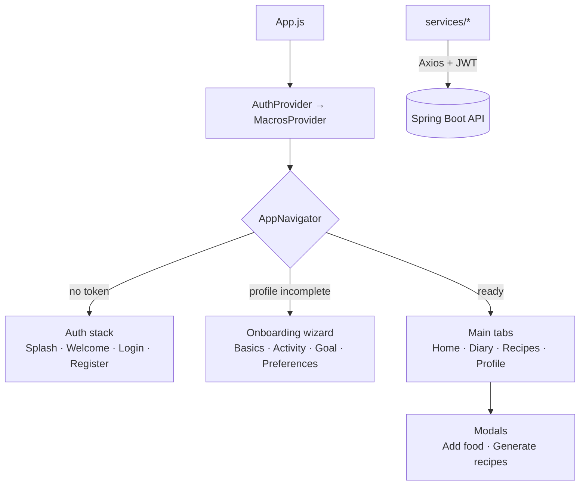

<p align="center">
  
</p>

<h1 align="center">CalorIA — Mobile App</h1>

<p align="center">
  An AI-powered nutrition coaching app for iOS and Android.<br/>
  Log meals in plain text, track your daily macros and get recipes generated to fit what you have left.
</p>

<p align="center">
  
  
  
  
  
</p>

---

## Overview

CalorIA is a full-stack project made of two parts:

- **This repository:** the cross-platform mobile client, built with React Native and Expo.
- **[caloria-backend](https://github.com/briansittmann/caloria-backend):** a Java / Spring Boot REST API with JWT authentication, MongoDB and OpenAI integration.

After a short onboarding, the app calculates personalised calorie and macro targets. Users then log meals by typing what they ate (for example "150 g chicken breast"). The backend works out the macros with AI and the app shows progress for the day in real time. When users don't know what to eat, CalorIA generates recipes that fit their remaining macros, preferences and allergies.

## Features

- **🔐 Authentication**: email and password sign-up and login. The JWT is stored on the device and attached to every request automatically.
- **🧭 Guided onboarding**: a 4-step wizard covering body data, activity level, goal, and preferences and allergies. It resumes where the user left off and can be reopened later from the profile to edit any step.
- **📊 Daily dashboard**: calories consumed and remaining, plus animated progress bars for protein, carbohydrates and fat.
- **🍗 AI meal logging**: add several foods with their weight in grams and send them for analysis. Macros are calculated by the backend's AI assistant and the dashboard refreshes instantly.
- **👨‍🍳 AI recipe generation**: generate 1–4 recipes fitted to the macros left for the day, then save, browse and delete them in *My recipes*.
- **🌗 Custom "nutritional day"**: users choose what time their day starts, so late-night meals count toward the right day.

## Technical highlights

- **Custom animated SVG component (`CircleFillWave`)**: a liquid-fill progress circle. The wave path is generated with `d3-shape` (Catmull-Rom curves) and animated with React Native's `Animated` API on the native driver, so it runs smoothly.
- **Auth-aware navigation**: the root navigator switches between three flows (*Auth → Onboarding wizard → Main app*) based on the token and the profile completion status from the API.
- **Global state with the Context API**: `AuthContext` handles the session, the token persisted in AsyncStorage and profile status. `MacrosContext` handles the daily summary, refreshes it when screens regain focus, and polls until onboarding is complete.
- **Centralised API layer**: one Axios instance with a request interceptor that injects the `Bearer` token. Domain services (`authService`, `foodService`, `recipeService`, etc.) keep HTTP logic out of the UI.
- **Reusable UI kit**: buttons, cards, tag inputs and loading states share a common theme palette.

## Tech stack

| Area | Technology |
|---|---|
| Framework | React Native 0.79, React 19, Expo SDK 53 (New Architecture enabled) |
| Language | JavaScript (ES2022) |
| Navigation | React Navigation 7 (native stack + bottom tabs) |
| State | React Context API |
| Networking | Axios with interceptors |
| Storage | AsyncStorage |
| Graphics | react-native-svg, d3-shape, react-native-progress |
| UI | @expo/vector-icons, react-native-elements, react-native-toast-message, native pickers |

## Architecture



## Getting started

### Prerequisites
- Node.js 18+ and npm
- The [Expo Go](https://expo.dev/go) app on your phone, or an Android or iOS emulator
- A running instance of **[caloria-backend](https://github.com/briansittmann/caloria-backend)**

### Installation

```bash
git clone https://github.com/briansittmann/CalorIA_SDK53.git
cd CalorIA_SDK53
npm install
```

### Point the app at your backend

Edit `src/config/api.js` and set `baseURL` to your machine's local IP address and the backend port:

```js
const API = axios.create({
  baseURL: 'http://<YOUR_LOCAL_IP>:8080',
});
```

> When using Expo Go on a physical device, use your computer's LAN IP (not `localhost`). Your phone and computer must be on the same network.

### Run

```bash
npm start          # start the Expo dev server, then scan the QR code with Expo Go
npm run android    # open in an Android emulator
npm run ios        # open in the iOS simulator (macOS only)
```

## Project structure

```
CalorIA_SDK53/
├── assets/              # Logos, mascot illustrations, app icon and splash
├── src/
│   ├── App.js           # Root component: context providers + navigator
│   ├── components/      # Reusable UI: MacronutrientCard, CircleFillWave, RecipeCard…
│   ├── config/          # Axios instance and JWT interceptor
│   ├── context/         # AuthContext, MacrosContext
│   ├── navigation/      # Root, auth, onboarding, main stack and tab navigators
│   ├── screens/         # App screens + onboarding wizard (profileScreens/)
│   ├── services/        # API calls grouped by domain
│   └── theme/           # Colour palette
├── app.json             # Expo configuration
└── package.json
```

> **Note:** the app was designed for a Spanish-speaking audience, so the UI text is in Spanish.

## Roadmap

- [ ] Meal history in the *Diary* tab
- [ ] Charts showing progress over weeks and months
- [ ] Environment-based API configuration (`app.config.js` / `EXPO_PUBLIC_*`)
- [ ] Handle expired sessions automatically (401 interceptor)
- [ ] Migrate to TypeScript and add component tests (Jest + React Native Testing Library)

## Author

**Brian Sittmann**: Junior Java Backend Developer
[GitHub](https://github.com/briansittmann) · [Portfolio](https://briansittmann.dev)
